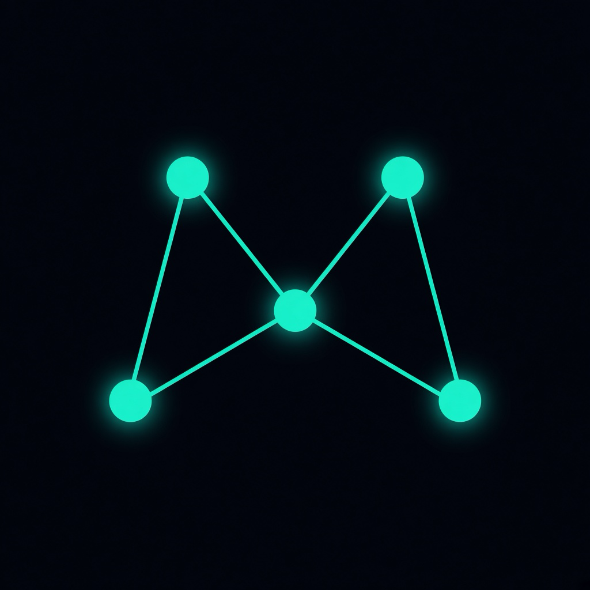

<p align="center">
  
</p>

<h1 align="center">Meshenger</h1>

<p align="center">
  <b>Text, call and share with people nearby, with no internet at all.</b><br>
  No Wi‑Fi, no cell signal, no account, no servers. Phones and computers pass your messages to each other over Bluetooth.
</p>

<p align="center">
  <a href="https://george-freedland.github.io/meshenger/"><b>Download</b></a> ·
  <a href="https://testflight.apple.com/join/VAkKgTBV">iPhone beta</a> ·
  <a href="RASPBERRY_PI.md">Raspberry Pi relay</a> ·
  <a href="#questions">Questions</a>
</p>

## Get the app

| Device | How |
| --- | --- |
| **iPhone and iPad** | [Join the free beta on TestFlight](https://testflight.apple.com/join/VAkKgTBV). It asks you to install Apple's TestFlight app first. |
| **Mac** | Get the `.dmg` from the [download page](https://george-freedland.github.io/meshenger/#download), open it, and drag Meshenger into Applications. |
| **Windows 10 and 11** | Get the `.zip` from the [download page](https://george-freedland.github.io/meshenger/#download), right-click it and choose **Extract All**, then open **meshenger.exe** in the new folder. If Windows says "Windows protected your PC", click **More info → Run anyway**. |
| **Android** | Get the `.apk` from the [download page](https://george-freedland.github.io/meshenger/#download) on your phone and open it. Allow installing from your browser when asked. |
| **Raspberry Pi** | [Set one up as a relay](RASPBERRY_PI.md) that extends everyone's range. |
| **Linux** | [Build it yourself](CONTRIBUTING.md#linux) (beta). |

Every version is also on the [releases page](https://github.com/George-Freedland/meshenger/releases). Meshenger is free: no ads, no tracking, no in-app purchases.

## What is it?

Meshenger is a messaging app that doesn't need the internet. Your message goes over Bluetooth straight to your friend's phone. If they're too far away, it hops through other phones, computers and small Raspberry Pi relays running Meshenger until it reaches them:

```
You  ──▶  a stranger's phone  ──▶  a Raspberry Pi on a windowsill  ──▶  your friend
```

Every message is locked with end-to-end encryption, so the devices in between can pass it along but can't read it. Nobody runs a server in the middle, not even us.

It's made for places where the internet doesn't reach or doesn't work: the subway, a flight, a festival, a hike, a basement, a power cut, or a crowd so big the cell network gives up.

## What you can do

- **Chat** one-on-one or in groups. Send photos, voice notes and files (any size in one-on-one chats). Edit or delete messages, make them disappear after a while, or send a photo that can only be viewed once.
- **Call** from any one-on-one chat, with voice or video. Calls work like a walkie-talkie: hold to talk, one person at a time.
- **Share music and videos.** Songs show their cover art and play right in the chat, often before they've finished downloading. Videos play in the app.
- **Post to Global**, a public board for everyone your mesh reaches.
- **Have your own website.** Your profile is also a small website, with pages you write, that travels from phone to phone.
- **See the mesh** on the Mesh Map: who's nearby, who you can reach through others, and, for people who choose to share their location, a 3D globe of where they are.
- **Stay in control.** Invisible mode takes you off everyone's map. You can block or report anyone, and keep several separate profiles on one device, each with its own password.

## Get started

1. Install Meshenger on two devices: two phones, or a phone and a computer.
2. Open it and agree to the terms. Pick an avatar, a nickname and a password, then tap **Create Identity**. There's no email or phone number. **Remember the password**: it can't be reset.
3. Turn on Bluetooth, and let Meshenger use it when asked.
4. Add each other. On one device, tap your name at the top of the home screen to show your QR code. On the other, open **Contacts → Add contact** and scan it. You can also tap someone on the **Mesh Map**.
5. Open **Messages** and say hi.

To see it work with no internet, turn on airplane mode on both devices, turn Bluetooth back on, and send another message.

## How far does it reach?

- One hop between two devices reaches about 10–50 meters, less through walls.
- Every device running Meshenger passes messages along, so the more people around you use it, the further it reaches.
- If there's no path right now, your message waits. Your device keeps trying, and devices that picked it up carry it for up to two days, so it arrives when someone walks into range.
- A $15 Raspberry Pi on a windowsill can fill the gap between houses. See [RASPBERRY_PI.md](RASPBERRY_PI.md).

## Privacy

- **Only you and the person you're talking to can read your messages**, calls and files. Devices relaying them only see scrambled data.
- **No account, no phone number, no servers.** Nothing is ever sent to us.
- **What others can see:** people nearby can see your nickname, your public key (your address) and that you're around. Invisible mode hides you. Global posts and your website are public.
- **Location is off** unless you turn it on in Settings → Location on the Mesh Map, either approximate (about 1 km) or exact.
- **Not audited yet.** Meshenger hasn't had an independent security review, so don't rely on it where your safety is at stake.

Read the [privacy policy](PRIVACY.md) and the [terms of use](TERMS.md).

## Good to know

- **Keep the app open for the best range.** iPhones and Android phones limit Bluetooth for apps in the background. On iPhone, swiping Meshenger away stops it until you open it again.
- **Big files take a while.** Bluetooth is slow: a photo takes seconds, a song a minute or two, and a 100 MB video around half an hour.
- **Windows and Linux can't scan QR codes.** Paste the other person's address instead, or tap them on the Mesh Map.
- **On Linux**, Meshenger finds other devices but can't be found by them yet. A [Pi relay](RASPBERRY_PI.md) running alongside fixes that.

## Questions

<details>
<summary><b>Does it really work without internet?</b></summary>

Yes. Meshenger only uses Bluetooth. It never uses Wi‑Fi, mobile data or any server.
</details>

<details>
<summary><b>Do I need to pair devices in Bluetooth settings?</b></summary>

No. Just open Meshenger on both. It never pairs, and an old pairing between two devices can actually stop them from seeing each other, so remove it if they don't connect.
</details>

<details>
<summary><b>My two devices don't see each other.</b></summary>

Check that Bluetooth is on for both and that they're within about 10 meters. On a Mac, allow Meshenger in System Settings → Privacy & Security → Bluetooth. Open the Mesh Map and tap refresh; finding each other can take up to 20 seconds.
</details>

<details>
<summary><b>Can the people relaying my messages read them?</b></summary>

No. They're encrypted on your device and only the recipient's device can unlock them. A relay only sees which addresses a message is from and to.
</details>

<details>
<summary><b>What happens if my friend is out of range?</b></summary>

The message waits and is delivered as soon as there's a path: they come back into range, someone walks between you, or a relay connects you. If it can't get through for a while, the message is marked so you know, and you can resend it.
</details>

<details>
<summary><b>Why does Android ask for location?</b></summary>

On Android 11 and older, the system only lets apps scan for Bluetooth devices with the location permission. On newer Android versions, Meshenger only asks if you turn on location sharing for the Mesh Map.
</details>

<details>
<summary><b>I forgot my password.</b></summary>

There's no way to recover it: your keys are locked with it, and there's no server holding a copy. Create a new identity and add your contacts again.
</details>

<details>
<summary><b>Is it really free?</b></summary>

Yes, and it's open source. There are no ads, no tracking and no in-app purchases.
</details>

## Help and contributing

- **Found a bug?** [Open an issue](https://github.com/George-Freedland/meshenger/issues). Say which devices you used, and paste the connection log: Messages → the receipt icon at the top → copy.
- **Ideas and questions:** [Discussions](https://github.com/George-Freedland/meshenger/discussions), or email george.meshenger@gmail.com.
- **Security problems:** please report them privately, as described in [SECURITY.md](SECURITY.md).
- **Developers:** [CONTRIBUTING.md](CONTRIBUTING.md) covers building from source, testing and releases, and [ARCHITECTURE.md](ARCHITECTURE.md) explains how the mesh works.

## License

Meshenger is free software under the [GNU GPL v3](LICENSE). Using it means agreeing to the [terms of use](TERMS.md).
